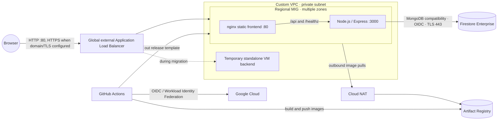

# Employee Admin Dashboard on Google Cloud

A three-tier employee dashboard: a global external Application Load Balancer serves an nginx frontend on a private regional managed instance group (MIG); nginx proxies requests to a Node.js/Express API; the API stores employee records in Firestore Enterprise with MongoDB compatibility.

The project also keeps a standalone VM attached to the load balancer as a temporary migration backend. See [the migration plan](docs/migration-plan.md) before removing it.

> **Security:** The dashboard currently has no user authentication. Anyone who can reach its load-balancer address can view and modify employee records. Use sample data only until authentication (for example, Identity-Aware Proxy) is implemented and verified.

## Architecture



The load balancer has a **public global IP**; it is not placed in a subnet. The MIG VMs have private addresses in `profile-app-subnet`. Private Google Access allows Google API access; Cloud NAT provides outbound internet access for image and package downloads. Firestore is a managed service outside the VPC, not a VM in the private subnet.

GitHub Actions uses Workload Identity Federation and short-lived credentials, not service-account key files. The application uses its VM service account and MongoDB OIDC authentication to connect to Firestore.

## Components and repository layout

| Path | Purpose |
|---|---|
| `backend/` | Node.js/Express API, validation, tests, seed script, and container build |
| `frontend/` | Static dashboard, nginx reverse proxy configuration, and container build |
| `infra/terraform/` | GCP APIs, VPC/subnet, firewall, MIG/template/autoscaling, load balancer, Firestore, Artifact Registry, IAM, and monitoring |
| `infra/bootstrap/` | One-time Terraform for remote state, GitHub OIDC pool/providers, service accounts, and IAM setup |
| `infra/mig-startup.sh` | Starts the frontend and backend containers on MIG instances and sends container logs to Cloud Logging |
| `infra/vm-startup.sh` | Startup support for the temporary standalone VM |
| `deploy/` | Legacy VM deployment and rollback files |
| `docker-compose.yaml` | Local development stack: frontend, backend, and MongoDB |
| `.github/workflows/ci.yml` | Backend checks for pull requests |
| `.github/workflows/terraform.yml` | Terraform plan and gated apply workflow |
| `.github/workflows/deploy-gce.yml` | Build/push application images and roll the MIG |
| `.github/workflows/bootstrap.yml` | Manual bootstrap workflow |
| `.github/workflows/oidc-check.yml` | Diagnostic workflow for GitHub-to-GCP OIDC |
| `docs/` | [Architecture](docs/architecture.md), [deployment](docs/deployment.md), [migration](docs/migration-plan.md), [monitoring](docs/monitoring.md), and [security](docs/security.md) guides |

## Request flow and API

The browser reaches nginx through the load balancer. Nginx serves the static UI and proxies `/api/*` and `/healthz` to the backend. The backend accesses Firestore over TLS using MongoDB compatibility.

| Method | Path | Purpose |
|---|---|---|
| GET | `/healthz` | Lightweight HTTP health endpoint for load-balancer checks |
| GET | `/api/health` | Checks backend-to-database connectivity |
| GET | `/api/meta` | Departments, statuses, and instance metadata |
| GET | `/api/employees` | List employees; supports exact-match `department` and `status` filters |
| GET | `/api/employees/:id` | Fetch one employee |
| POST | `/api/employees` | Create an employee |
| PUT | `/api/employees/:id` | Partially update an employee |
| DELETE | `/api/employees/:id` | Delete an employee |

Employee data is stored in the `employees` collection. The API validates and normalizes fields; see `backend/src` for the authoritative schema and behavior.

## CI/CD and identity

### Terraform

- Pull requests affecting `infra/terraform/` run a plan with the read-only `tf-plan` identity.
- Changes merged to `main` run a new plan. The `apply` job waits for approval in the GitHub `infra` environment, then applies the saved plan with `tf-apply`.
- Create the `infra` environment and configure its required reviewer before relying on this gate.

### Application release

- The release workflow tests the backend, builds SHA-tagged frontend/backend images, pushes them to Artifact Registry, updates the regional MIG, and checks the public endpoints.
- The workflow is configured for manual dispatch from `main`. Automatic deployment on matching pushes stays disabled until the repository Actions variable `AUTO_DEPLOY` is set to `true`.
- Run the first application release manually after Terraform has created the baseline infrastructure.
- Terraform owns the baseline instance template and MIG configuration; the release workflow creates versioned release templates and rolls the MIG. Keep old release images/templates for the rollback window.

Each workflow uses its dedicated Workload Identity provider and service account. Repository variables are identifiers/configuration, not credentials; do not add service-account JSON keys.

> **Local branch note:** This README was reviewed in the local `dev` checkout. Its `deploy-gce.yml` currently differs from the successfully updated `main` workflow: it uses an older health-field check and a 20-minute MIG wait. Sync the local branch with the current `main` workflow before relying on a local copy of that workflow. The documented deployment behavior describes the intended/current main-branch release flow.

## First-time setup

1. Push the repository to GitHub and select the intended Google Cloud project.
2. Review [bootstrap instructions](infra/bootstrap/README.md). Set `project_id` and `github_repo` in the ignored local `terraform.tfvars`; do not commit it.
3. Run bootstrap only after reviewing its Terraform plan. It creates the state bucket, Workload Identity resources, service accounts, and IAM bindings.
4. Publish the exact outputs from `terraform output github_variables` as GitHub Actions repository variables. Use the actual generated project number and resource names; do not guess or copy values from an old project.
5. Configure GitHub branch protection and the `infra` environment approval gate.
6. Merge the infrastructure configuration to `main`; review the plan and approve the gated apply.
7. Manually run **Build & deploy to GCE** from `main`. Confirm the workflow's smoke tests pass before enabling `AUTO_DEPLOY=true`.

See [deployment guide](docs/deployment.md) for migration order, state handling, variables, and rollback steps. Do not run Terraform against a different state bucket/prefix or change backend configuration casually; that can make Terraform treat existing infrastructure as unmanaged.

## Local development

Requirements: Docker Desktop, and Node.js 22 if running backend tests directly.

```sh
docker compose up --build
docker compose exec backend npm run seed
```

Open [http://localhost:8080](http://localhost:8080). The local stack uses MongoDB with development-only credentials; these are not GCP credentials.

Run backend tests:

```sh
cd backend
npm ci
npm test
```

Terraform validation without connecting to the remote state:

```sh
cd infra/terraform
terraform fmt -check -recursive
terraform init -backend=false
terraform validate
```

## Networking and security notes

- The MIG subnet is private; instances have no public IP addresses.
- The global load balancer accepts public HTTP on port 80. HTTPS requires a configured domain, DNS pointing to the load-balancer IP, and managed certificate configuration.
- Firewall ingress is limited to load-balancer/health-check traffic and IAP SSH for administration.
- Firestore is outside the VPC. The application reaches it through Google APIs using Private Google Access and IAM; there is no database inbound firewall rule.
- The dashboard has no end-user authentication yet. Network reachability to the load balancer currently grants access to employee CRUD operations.
- Keep the legacy VM/backend until the MIG and database health checks pass and the migration plan says it is safe to remove.

## Observability and operations

Terraform provisions Cloud Monitoring resources and log groups; application/container logs are sent to Cloud Logging. See [monitoring guide](docs/monitoring.md) for dashboards, alert policies, and notification-channel configuration.

The app URL and monitoring dashboard resource are Terraform outputs. Retrieve them from the Terraform state after apply; use the load-balancer URL output to open the application. For release rollback, rerun a known-good deployment or roll the MIG to a retained release template, then verify `/healthz`, `/api/health`, and the dashboard.

## Cost and cleanup

The load balancer, regional MIG instances, Cloud NAT, Firestore, Artifact Registry, logs, and monitoring can incur charges. Review resource sizing, scaling limits, retention, and budget alerts for the selected project.

The workflows do not destroy infrastructure. Before cleanup, review [deployment](docs/deployment.md) and [migration](docs/migration-plan.md), confirm backups/retention needs, and inspect the Terraform destroy plan. Do not delete the state bucket until infrastructure teardown is complete.
